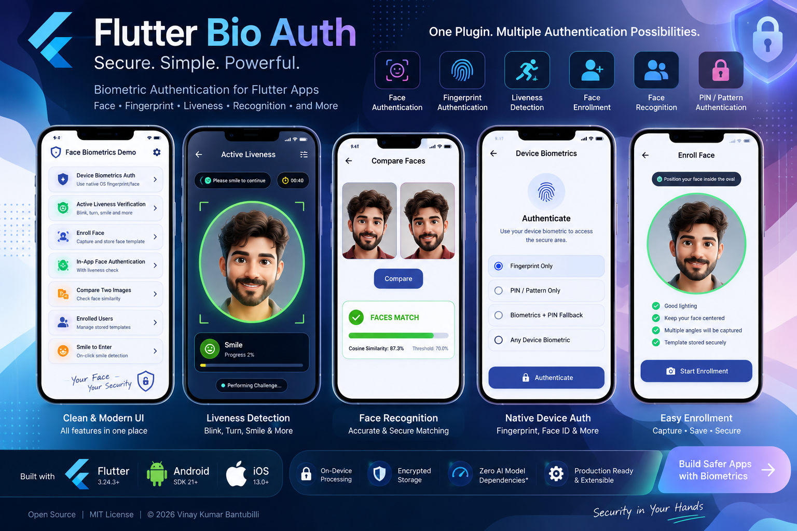

# Flutter Bio Auth

<p align="center">
  
</p>

<p align="center">
  <strong>Advanced authentication and biometric security for Flutter.</strong>
</p>

<p align="center">
  Face Recognition · Liveness Detection · Fingerprint · Face ID · Pattern · Password
</p>

<p align="center">

[](https://pub.dev/packages/flutter_bio_auth)
[](https://pub.dev/packages/flutter_bio_auth/score)
[](LICENSE)
[](https://flutter.dev)
[](https://dart.dev)

</p>

---

## Overview

**Flutter Bio Auth** is a Flutter authentication plugin that provides multiple authentication mechanisms through a unified API.

It supports platform-native device authentication as well as application-controlled face authentication workflows.

### Authentication methods

* 🔐 Device biometrics
* 👆 Fingerprint
* 🙂 Face ID / device face authentication
* 👤 Face recognition
* 🛡️ Active liveness detection
* 🔎 Optional passive anti-spoofing
* 🔢 Pattern authentication
* 🔑 Password authentication
* 🔄 Authentication fallback flows
* 💾 Secure local biometric template storage

The plugin is designed for **on-device processing** and does not require a cloud service for its core authentication pipeline.

---

# Features

## Device Biometrics

Use the secure biometric authentication mechanisms provided by Android and iOS.

Depending on the device and operating system, supported methods may include:

* Fingerprint
* Face authentication
* Android BiometricPrompt
* iOS Face ID
* iOS Touch ID
* Device credential fallback

Native device biometric authentication is handled by the operating system and remains subject to the security model of the platform.

> Raw fingerprint or Face ID biometric data is not exposed to Flutter applications.

---

## Face Recognition

The plugin provides an application-controlled face recognition pipeline.

Typical workflow:

```text
Camera
  ↓
Face Detection
  ↓
Face Quality
  ↓
Face Alignment
  ↓
Face Embedding
  ↓
1:1 Face Matching
  ↓
Authentication Result
```

Face recognition supports:

* Face enrollment
* Face template generation
* Face template storage
* 1:1 face comparison
* Authentication against an enrolled template

The recognition engine is designed to be injectable so that applications can integrate a compatible face embedding model.

---

## Active Liveness Detection

Active liveness detection can use user interaction challenges to verify that the captured face belongs to a live person.

Example challenges include:

* Blink
* Smile
* Turn left
* Turn right
* Look up
* Look down
* Head movement

Example:

```text
Face Detected
      ↓
Quality Check
      ↓
"Turn Left"
      ↓
"Blink"
      ↓
"Smile"
      ↓
Liveness Passed
```

> Active liveness detection should not be considered a certified Presentation Attack Detection (PAD) solution.

Applications requiring high-security biometric authentication should independently evaluate the complete authentication system against their threat model.

---

## Passive Anti-Spoofing

The plugin supports an injectable anti-spoofing engine.

A strong authentication flow can require multiple independent checks:

```text
Face Recognition
       AND
Liveness Detection
       AND
Anti-Spoofing
       ↓
Authentication
```

If a required security component is unavailable, the authentication pipeline can fail closed rather than bypassing the security check.

---

## Pattern Authentication

Pattern authentication can be used as an additional authentication method or fallback.

Example:

```text
Biometric
    ↓
Failed / Unavailable
    ↓
Pattern
    ↓
Authenticated
```

Pattern credentials should be stored securely and should never be stored as plaintext.

---

## Password Authentication

Password authentication can be used as another fallback mechanism.

Example:

```text
Face / Fingerprint
        ↓
Unavailable
        ↓
Pattern
        ↓
Unavailable
        ↓
Password
```

Applications should use secure password hashing and should never store plaintext passwords.

---

# Authentication Architecture

The plugin separates the Flutter API from platform-specific authentication and computer-vision components.

```text
                    Flutter Application
                           │
                           ▼
                ┌─────────────────────┐
                │   Flutter Bio Auth  │
                │                     │
                │ FaceBiometric       │
                │ Controller          │
                │ Configuration       │
                │ Authentication      │
                └──────────┬──────────┘
                           │
             ┌─────────────┴─────────────┐
             │                           │
             ▼                           ▼
       Android Platform            iOS Platform
             │                           │
       ┌─────┴─────┐               ┌─────┴─────┐
       │           │               │           │
     Camera      Biometrics      Camera      Biometrics
       │           │               │           │
     CameraX    BiometricPrompt  AVFoundation Local Auth
       │                           │
     ML Kit                       Vision
       │                           │
     TFLite                       Core ML
       │                           │
    Keystore                     Keychain
```

---

# Installation

Add the package to your `pubspec.yaml`:

```yaml
dependencies:
  flutter_bio_auth: ^0.1.0
```

Then run:

```bash
flutter pub get
```

---

# Platform Support

| Platform | Support |
| -------- | ------- |
| Android  | ✅       |
| iOS      | ✅       |
| Web      | ❌       |
| Windows  | ❌       |
| macOS    | ❌       |
| Linux    | ❌       |

The current implementation focuses on Android and iOS.

---

# Requirements

### Flutter

```text
Flutter >= 3.24.3
Dart >= 3.5.0
```

### Android

```text
Minimum SDK: 21
Compile SDK: 34
```

### iOS

```text
Deployment Target: iOS 13.0+
Swift: 5
```

---

# Android Configuration

Add camera permission to your application:

```xml
<uses-permission android:name="android.permission.CAMERA" />
```

Request camera permission at runtime before starting face authentication.

For native device biometrics, configure the Android application according to the Android biometric requirements for your target SDK and devices.

---

# iOS Configuration

Add camera permission to:

```text
ios/Runner/Info.plist
```

```xml
<key>NSCameraUsageDescription</key>
<string>
Camera access is required for face authentication and liveness detection.
</string>
```

For Face ID, add the appropriate Face ID usage description if your application uses Face ID.

---

# Basic Usage

Import the package:

```dart
import 'package:flutter_bio_auth/flutter_bio_auth.dart';
```

Create your configuration:

```dart
final config = FaceBiometricConfig(
  recognitionThreshold: 0.82,
  livenessThreshold: 0.80,
  antiSpoofThreshold: 0.80,
  enableLiveness: true,
  enableAntiSpoofing: true,
);
```

Create the authentication controller:

```dart
final controller = FaceBiometricController(
  config: config,
);
```

---

# Device Biometric Authentication

Use the platform's secure biometric authentication:

```dart
final result =
    await FaceBiometric.authenticateWithDeviceBiometrics();

if (result.isAuthenticated) {
  print('Authentication successful');
} else {
  print('Authentication failed');
}
```

The native biometric prompt and secure biometric operation remain controlled by Android and iOS.

---

# Face Enrollment

A typical enrollment flow is:

```text
Start Enrollment
      ↓
Open Camera
      ↓
Detect Face
      ↓
Check Face Quality
      ↓
Perform Liveness
      ↓
Generate Face Embedding
      ↓
Encrypt Template
      ↓
Store Template
```

Example:

```dart
final result = await FaceBiometric.enroll(
  userId: 'user-123',
);

if (result.isSuccess) {
  print('Face enrolled successfully');
}
```

---

# Face Authentication

After enrollment:

```dart
final result = await FaceBiometric.authenticate(
  userId: 'user-123',
);

if (result.isAuthenticated) {
  print('Face authentication successful');
}
```

The authentication pipeline can evaluate:

```text
Face Detection
      ↓
Face Quality
      ↓
Liveness
      ↓
Anti-Spoofing
      ↓
Face Embedding
      ↓
1:1 Matching
      ↓
Authentication
```

---

# Face Matching

Face matching is performed using face embeddings.

Conceptually:

```text
Enrolled Face
      ↓
Embedding
      │
      ├──────────────┐
      │              │
      ▼              ▼
Current Face     Enrolled Template
      │              │
      ▼              │
Embedding           │
      │              │
      └──────┬───────┘
             ↓
     Cosine Similarity
             ↓
          Threshold
             ↓
        Match / No Match
```

The default example configuration uses:

```text
Recognition threshold: 0.82
```

The appropriate threshold depends on the selected model, data, camera conditions, and application's security requirements.

**Do not treat 0.82 as a universal biometric security threshold.**

---

# AI Model Integration

Face recognition and passive anti-spoofing require compatible AI models.

The plugin provides injectable interfaces for model integration.

### Face Embedding

```text
FaceEmbeddingEngine
        │
        └── TFLite / Core ML
```

### Anti-Spoofing

```text
AntiSpoofEngine
        │
        └── TFLite / Core ML
```

A typical face recognition model may use:

```text
Input:
112 × 112 × 3 RGB

Data type:
Float32

Normalization:
(pixel - 127.5) / 127.5

Output:
Face embedding vector

Comparison:
Cosine similarity
```

The exact model requirements depend on the engine implementation.

> You are responsible for ensuring that any AI model bundled with your application has appropriate licensing and redistribution rights.

---

# Secure Storage

Biometric templates should not be stored as raw face images.

The intended architecture is:

```text
Face
 ↓
Face Embedding
 ↓
Encryption
 ↓
Secure Local Storage
```

### Android

```text
Android Keystore
       ↓
Encryption Key
       ↓
AES-GCM
       ↓
Encrypted Template
       ↓
Local Storage
```

### iOS

```text
iOS Keychain
      ↓
Encryption Key
      ↓
AES-GCM
      ↓
Encrypted Template
      ↓
Local Storage
```

The plugin is designed to keep biometric processing and template storage on-device.

---

# Authentication Fallback

Applications can combine multiple authentication methods.

Example:

```text
       ┌───────────────┐
       │ Face / Device │
       │   Biometric   │
       └───────┬───────┘
               │
        Failed / Unavailable
               ↓
       ┌───────────────┐
       │    Pattern    │
       └───────┬───────┘
               │
        Failed / Unavailable
               ↓
       ┌───────────────┐
       │    Password   │
       └───────────────┘
```

The exact fallback strategy should be selected based on the application's security requirements.

---

# Security

Flutter Bio Auth follows a security-oriented architecture.

### Security features

* On-device face processing
* Encrypted biometric templates
* Android Keystore integration
* iOS Keychain integration
* AES-GCM encryption
* Fail-closed behavior for unavailable required AI components
* Explicit authentication gates
* No requirement for cloud face processing
* No raw face image required for biometric template storage

A strong authentication configuration can require:

```text
Recognition = PASS
        AND
Liveness = PASS
        AND
Anti-Spoof = PASS
```

If a required condition fails:

```text
Authentication = FAILED
```

---

# Privacy

The core face authentication pipeline is designed to operate locally on the device.

The plugin does not require a cloud backend for:

* Face detection
* Face liveness
* Face embedding
* Face matching
* Local biometric template storage

Applications remain responsible for:

* Obtaining user consent
* Providing appropriate privacy disclosures
* Managing biometric data lifecycle
* Implementing data deletion
* Meeting applicable privacy and regulatory requirements

---

# UI Integration

The plugin can be integrated with a custom Flutter authentication UI.

For example:

```text
┌──────────────────────────────┐
│                              │
│      Face Authentication     │
│                              │
│        ┌────────────┐        │
│        │            │        │
│        │    FACE    │        │
│        │            │        │
│        └────────────┘        │
│                              │
│       Please blink           │
│                              │
│       ● ● ○ ○ ○              │
│                              │
└──────────────────────────────┘
```

Flutter can react to authentication states and display:

* Face guide
* Progress indicators
* Liveness instructions
* Success animations
* Failure states
* Retry actions
* Authentication method selection

> System biometric authentication on Android and iOS remains controlled by the operating system and its security UI.

---

# Error Handling

Authentication should always be treated as a potentially unsuccessful operation.

Example:

```dart
final result = await FaceBiometric.authenticate(
  userId: 'user-123',
);

switch (result.status) {
  case AuthenticationStatus.authenticated:
    print('Authenticated');
    break;

  case AuthenticationStatus.failed:
    print('Authentication failed');
    break;

  case AuthenticationStatus.cancelled:
    print('Authentication cancelled');
    break;

  case AuthenticationStatus.unavailable:
    print('Authentication unavailable');
    break;

  default:
    print('Authentication state: ${result.status}');
}
```

---

# Testing

Run static analysis:

```bash
flutter analyze
```

Run unit tests:

```bash
flutter test
```

Run the example application:

```bash
cd example
flutter pub get
flutter run
```

For production applications, test on physical devices and across different:

* Android versions
* iOS versions
* Camera hardware
* Lighting conditions
* Face angles
* User demographics
* Authentication states
* Biometric configurations
* Camera permission states
* Device lockout conditions
* AI model availability conditions

---

# Example Application

A complete example application is included in the repository.

See:

```text
example/
```

For example application setup and usage, see the [`example/README.md`](example/README.md).

---

# Project Structure

```text
flutter_bio_auth/
│
├── android/
│   └── src/main/
│
├── ios/
│   └── Classes/
│
├── lib/
│   ├── flutter_bio_auth.dart
│   └── src/
│
├── test/
│
├── example/
│
├── assets/
│   └── flutter_bio_auth_banner.png
│
├── CHANGELOG.md
├── LICENSE
├── README.md
└── pubspec.yaml
```

---

# Current Status

Flutter Bio Auth is currently in the **0.x development stage**.

The core architecture and APIs are under active development.

Some functionality may require additional physical-device testing and compatible AI model integration before being used in production authentication systems.

### Current limitations

* Face recognition requires a compatible embedding model.
* Passive anti-spoofing requires a compatible anti-spoofing model.
* Model accuracy depends on the selected model and calibration.
* Active liveness is not a certified PAD solution.
* Android and iOS native biometric behavior is controlled by the operating system.
* Production deployments should perform their own security and device compatibility validation.

---

# Roadmap

* [ ] Additional face recognition models
* [ ] Additional anti-spoofing models
* [ ] Improved face alignment
* [ ] Improved liveness challenges
* [ ] Expanded device compatibility
* [ ] Performance optimizations
* [ ] Improved biometric template lifecycle management
* [ ] Additional authentication fallback strategies
* [ ] Expanded physical-device test coverage
* [ ] More authentication UI components
* [ ] Improved documentation

---

# Contributing

Contributions are welcome.

Before submitting a pull request, run:

```bash
flutter analyze
flutter test
```

Please include appropriate tests when adding or modifying functionality.

---

# Security

If you discover a security vulnerability, please do not disclose it through a public GitHub issue.

Please follow the security reporting instructions in [`SECURITY.md`](SECURITY.md).

---

# License

Flutter Bio Auth is released under the MIT License.

See [`LICENSE`](LICENSE) for details.

---

# Disclaimer

Flutter Bio Auth is an open-source authentication library and is **not a certified biometric security product**.

Applications using this package for sensitive or high-security authentication should independently perform:

* Security assessment
* Threat modeling
* Biometric accuracy evaluation
* Presentation-attack evaluation
* Device compatibility testing
* Privacy review
* Regulatory compliance review

Do not represent an application as providing certified biometric authentication unless the complete deployed system has been independently evaluated and certified.

---

## Support

If you encounter a problem or have a feature request, please open an issue in the GitHub repository.

If you find Flutter Bio Auth useful, consider giving the project a ⭐.
